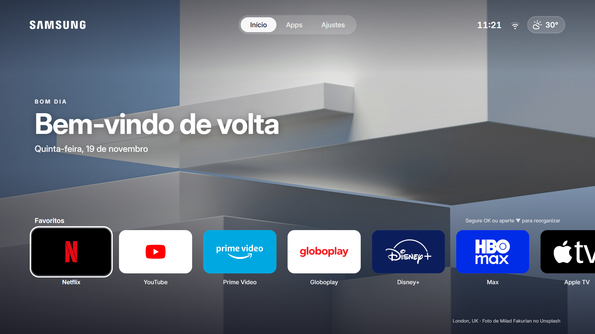
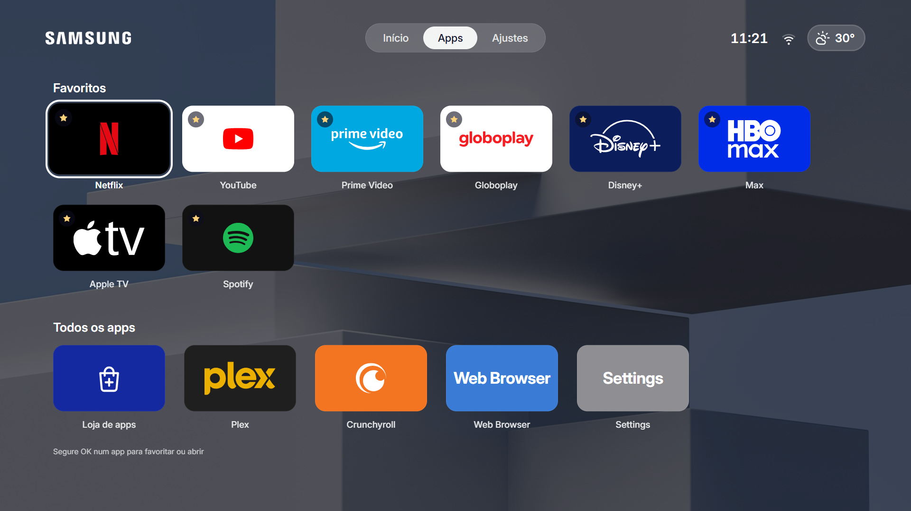
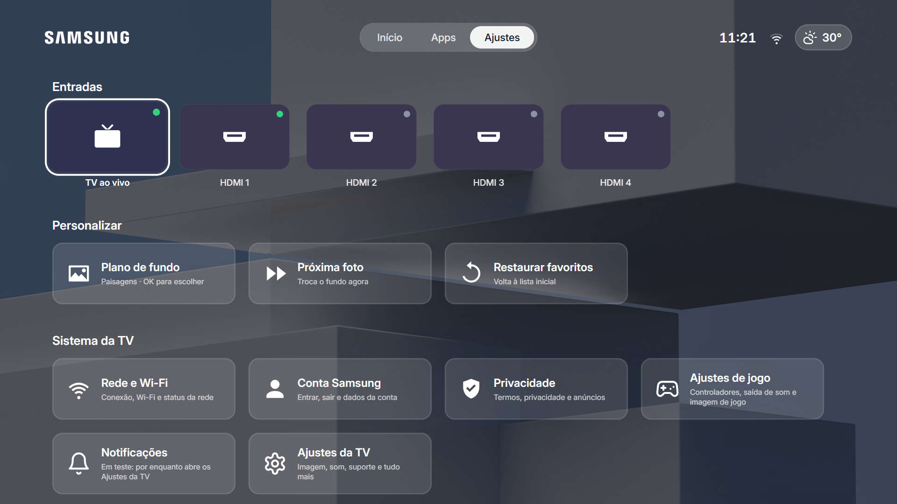
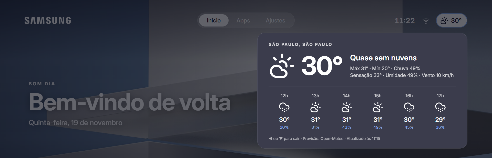

<div align="center">

# 🌅 Dusk TV

**Uma tela inicial limpa, rápida e personalizável para Smart TVs Samsung (Tizen) e LG (webOS).**

Fotos que mudam sozinhas, do tipo que você escolher, seus apps com os logos de verdade, relógio, Wi-Fi e clima. Sem propaganda,
sem fileiras patrocinadas.


-A50034?style=for-the-badge&logo=lg&logoColor=white)
-0F172A?style=for-the-badge)




</div>

---

## 📺 Escolha sua TV

O mesmo app, com um pacote para cada marca. O visual e as funções são os mesmos; o logo, a loja de apps e os atalhos
de Ajustes seguem a marca da TV sozinhos.

| Sua TV | Situação | Pacote | Como instalar |
| --- | --- | --- | --- |
| **Samsung** (Tizen 3.0+, 2017 em diante) | ✅ Testado numa UN60AU8000 | `DuskTV.wgt`, gerado e assinado no seu computador | [Instalação na Samsung](#-instalação-na-samsung) |
| **LG** (webOS 3.0+, 2016 em diante) | 🧪 Experimental: ainda não testado numa TV de verdade | `DuskTV-LG.ipk`, pronto na [página de releases](../../releases/latest) | [Instalação na LG](#-instalação-na-lg-experimental) |
| **Android TV / Google TV** | 🛠️ Planejado | Ainda não existe | Acompanhe nas [issues](../../issues) |

> Tem uma LG? Instale, use e conte numa [issue](../../issues) como foi, com o modelo da TV. É assim que ela sai do
> "experimental".

---

## Sumário

- [Telas](#-telas)
- [Funcionalidades](#-funcionalidades)
- [Compatibilidade](#-compatibilidade)
- [Tecnologias](#-tecnologias)
- [Instalação na Samsung](#-instalação-na-samsung)
- [Instalação na LG (experimental)](#-instalação-na-lg-experimental)
- [Personalização](#-personalização)
- [Estrutura do projeto](#-estrutura-do-projeto)
- [Limites das TVs](#-limites-das-tvs)
- [Como desfazer](#-como-desfazer)
- [Contribuindo](#-contribuindo)
- [Créditos](#-créditos)
- [Licença](#-licença)

---

## 🖼️ Telas

### Início
Saudação conforme o horário, data, paisagem de fundo com a legenda do lugar e a fileira de **Favoritos**.
Segure **OK** num favorito para arrastá-lo com as setas.


### Apps
Seus **Favoritos** ficam numa seção própria no topo, e logo abaixo vêm **Todos os apps**, com um bloco para abrir a
**Loja de apps** da TV. Cada app aparece com o **logo oficial** sobre a cor da marca. Segure **OK** num app
para abrir um menu com **Favoritar** (ou **Tirar dos favoritos**) e **Abrir**. Os outros apps escurecem enquanto ele
está aberto.



### Ajustes
Entradas (TV ao vivo e HDMI 1 a 4, com um ponto verde quando há um aparelho ligado), plano de fundo, Rede e
Wi-Fi, Conta Samsung (ou Conta LG), Privacidade e os Ajustes da TV. Na Samsung, também **Ajustes de jogo**
(controladores, saída de som e imagem de jogo) e Notificações (em teste).



### Barra superior
Logo da marca da TV, abas, relógio, força do sinal do **Wi-Fi** (ou o ícone de cabo de rede) e o **clima**: o ícone
do tempo e a temperatura. Ao chegar nele, abre a previsão com o local, a máxima e a mínima, a chance de chuva, a
sensação, a umidade, o vento e as próximas 6 horas; ◀ ou ▼ fecham.



---

## ✨ Funcionalidades

- 🏞️ **Fundo do seu jeito:** em Ajustes → Plano de fundo, marque **Paisagens**, **Animais**, **Arquitetura**,
  **Abstratos**, qualquer mistura deles ou **Todas**. As fotos trocam a cada 20 minutos e vêm do
  [Unsplash](https://unsplash.com), com uma chave gratuita ([como configurar](#-fotos-do-unsplash)). Sem chave, vêm
  as "imagens do dia" do Bing, separadas pelo título.
- 📴 **Funciona sem internet:** 5 paisagens salvas no próprio app entram quando a rede cai, ou sempre, com
  "Só as salvas".
- 🎨 **Logos de verdade** para cerca de 30 apps: Netflix, YouTube, Prime Video, Globoplay, Disney+, HBO Max,
  Apple TV, Spotify, Twitch, Crunchyroll, Plex, Paramount+, PlayStation, Xbox e outros.
- ⭐ **Favoritos editáveis pelo controle:** adicionar, tirar e reorganizar. Na aba Apps, eles ficam numa seção separada.
- 🛍️ **Loja de apps** da TV (a da Samsung ou a LG Content Store) a um clique, na aba Apps.
- 📶 **Status da rede** em tempo real: força do Wi-Fi ou cabo.
- 🌤️ **Clima na barra:** temperatura e ícone do tempo agora. Ao passar por ele, abre a previsão do dia e das
  próximas 6 horas. Vem do [Open-Meteo](https://open-meteo.com), sem chave, para a cidade da sua internet (ou a que
  você fixar no `config.js`).
- 🔔 **Notificações:** o cartão em Ajustes abre os Ajustes da TV. O painel de notificações da Samsung ainda está
  [em investigação](#-notificações-em-investigação).
- 🎮 **Ajustes de jogo (Samsung):** o painel de jogos da Samsung, com controladores, saída de som e imagem de jogo, a um clique.
- 🔌 **Entradas HDMI** com status de conexão.
- ⚙️ **Identidade visual** num só arquivo: logo, cor de destaque, tipo de fundo e favoritos iniciais.
- 🪶 **Leve e rápido:** JavaScript puro, sem frameworks, sem sombras e sem blur. Os favoritos aparecem em cerca de 0,5 s, e a navegação roda a 60 quadros por segundo, medido numa UN60AU8000.
- 📺 **Samsung e LG:** o mesmo app nas duas marcas, com o logo, a loja e os atalhos de cada uma.
- ↩️ **Reversível:** não mexe no sistema da TV, no botão Home nem no Smart Hub.

---

## 📺 Compatibilidade

| | Samsung | LG |
| --- | --- | --- |
| **Testado em** | UN60AU8000GXZD (Crystal UHD 2021, Tizen 6.0) | Ainda em nenhuma (experimental) |
| **Deve funcionar em** | Tizen 3.0 ou mais novo (2017 em diante) | webOS 3.0 ou mais novo (2016 em diante) |
| **Instalação** | Modo Desenvolvedor e certificado: Tizen comum (2015 a 2022) ou Samsung (2023 em diante) | App Developer Mode da LG, com conta gratuita de desenvolvedor |
| **Resolução da interface** | 1920×1080, ajustada à tela | 1920×1080 (TVs 4K) ou 1280×720 (Full HD e HD), ajustada à tela |

> Testou em outro modelo? Abra uma [issue](../../issues) contando como foi, para entrar nesta tabela.

---

## 🧰 Tecnologias

| Parte | O que usa |
| --- | --- |
| Interface | HTML5, CSS3 e JavaScript **ES5** (o navegador das TVs Tizen e webOS é antigo), fonte [Inter](https://rsms.me/inter/) |
| Integração com a TV | Samsung: APIs web do Tizen, `tizen.application` (apps), `tizen.systeminfo` (Wi-Fi e rede) e `tizen.tvwindow` (HDMI). LG: o barramento de serviços do webOS (Luna), com `applicationManager` (apps), `connectionmanager` (rede) e `eim` (HDMI) |
| Fotos online | [API do Unsplash](https://unsplash.com/developers) (tópicos de fotos, chave gratuita) ou o arquivo de imagens do dia do Bing (`HPImageArchive`), sem chave |
| Clima | [Open-Meteo](https://open-meteo.com) (previsão, sem chave) e [ipinfo.io](https://ipinfo.io) para achar a cidade pela internet |
| Empacotamento | Samsung: Python 3 (`tizen/build.py`) e o `tizen package` do Tizen SDK 10 para assinar. LG: Python 3 (`webos/build.py`), que monta o `.ipk` sem ferramentas da LG |
| Instalação | Samsung: Python 3 (`tizen/install.py`), que fala o protocolo SDB da TV direto. LG: Python 3 e OpenSSH (`webos/install.py`) |
| Base | Camada de TV do [Free My TV](https://github.com/simbasjungles/free-my-tv) (MIT) |

---

## 🚀 Instalação na Samsung

Os passos 1 a 3 são feitos uma vez só.

**1. Na TV, ligue o Modo Desenvolvedor**
1. Abra **Apps** e espere a tela carregar.
2. Digite `1 2 3 4 5` no controle **rápido, em no máximo 2 segundos**. Mais devagar que isso, a TV ignora e a
   janela não abre.
   - No Smart Remote (o controle sem números), aperte o botão **123** para abrir o teclado numérico na tela antes.
3. Ligue o **Developer mode**.
4. Em **Host PC IP**, coloque o IP do seu computador. No Windows, rode `ipconfig` e use o "Endereço IPv4" do
   adaptador **Wi-Fi** ou **Ethernet**, que é o que tem "Gateway Padrão" preenchido (algo como `192.168.0.x`).
   Ignore IPs que começam com `169.254` e adaptadores de VPN (Tailscale, Hamachi etc.): a TV não alcança esses
   endereços.
5. Desligue e ligue a TV: segure o botão de ligar até ela reiniciar.
6. Anote o IP da TV, que aparece em Configurações → Geral → Rede → Status da rede → Configurações de IP. Ele é
   usado no passo 4, no comando `install.py`.

> **Errou o IP do computador?** Repita os passos 1 e 2. A mesma janela abre de novo para você corrigir o
> **Host PC IP**. Depois, reinicie a TV.

**2. No computador, instale o Tizen SDK**

O Tizen Studio agora se chama **Tizen SDK** e fica na página de [Tools do Samsung Tizen OS](https://samsungtizenos.com/tools-download/).
No Windows, baixe a versão com interface gráfica, que já traz o Certificate Manager:

- **Windows (64-bit):** [web-ide_Tizen_SDK_10.0_windows-64.exe](https://download.tizen.org/sdk/Installer/tizen-sdk_10.0/web-ide_Tizen_SDK_10.0_windows-64.exe)
- **Outros sistemas e espelhos:** [download.tizen.org/sdk/Installer/tizen-sdk_10.0](https://download.tizen.org/sdk/Installer/tizen-sdk_10.0/)

Instale na pasta sugerida (`C:\tizen-studio`). Se escolher outra, defina a variável de ambiente `TIZEN_STUDIO`
com o caminho. Também é preciso ter o [Python 3](https://www.python.org/downloads/).

> Se o Windows bloquear o instalador, clique em "Mais informações" e depois em "Executar assim mesmo". O instalador
> precisa do Java, e oferece para instalar se não encontrar.

**3. Crie o certificado**

1. Abra o **Certificate Manager**: no menu Iniciar, ou em `C:\tizen-studio\tools\certificate-manager\`.
2. Clique em **+** e escolha o tipo:
   - **Tizen:** TVs de 2015 a 2022, como a UN60AU8000.
   - **Samsung:** TVs de 2023 em diante. Precisa da extensão *Samsung Certificate Extension*, instalada pelo
     Package Manager do SDK, e de login na conta Samsung.
3. Dê o nome `dusk` ao perfil e crie um certificado de autor novo, com uma senha só sua.

**Atalho para TVs até 2022 (Windows):** em vez do Certificate Manager, rode o script abaixo. Ele pede uma senha e
cria o certificado e o perfil `dusk` sozinho.

```bash
powershell -ExecutionPolicy Bypass -File tools\criar-certificado.ps1
```

**4. Gere e instale o app**

```bash
git clone https://github.com/mkrosz/dusk-tv.git
cd dusk-tv
python tizen/build.py --sign dusk
python tizen/install.py IP_DA_TV
```

Troque `IP_DA_TV` pelo IP que você anotou no passo 1 (por exemplo, `python tizen/install.py 192.168.0.20`). O
app abre sozinho na TV no fim do último comando.

**5. Na TV, deixe o Dusk TV a um clique**

Este passo é feito **na TV, com o controle** (não no Tizen Studio):

1. Aperte **Home** e, na barra da Samsung, vá até o **Dusk TV**.
2. Aperte **▼** (ou segure OK) e escolha **Mover**.
3. Leve o Dusk TV para o **começo da barra** e confirme com OK.

Agora, de qualquer lugar, **Home → Dusk TV** abre a tela.

> **E o "Executar automaticamente último app"?** Na UN60AU8000, ele não abre o Dusk TV ao ligar a TV. Testamos com o
> app aberto pela barra e pelo computador, e com os mesmos avisos que Netflix e YouTube usam para isso
> (`appbootingsupport`, `prelaunch.support` e `eden_resume`). Em todas as vezes, a TV ligou na TV ao vivo. Tudo indica
> que a Samsung só aplica essa função a apps da loja dela. Veja [Limites das TVs](#-limites-das-tvs).

> Mudou alguma coisa? Rode de novo só o passo 4.

---

## 🧪 Instalação na LG (experimental)

> **Ainda não testado numa LG de verdade.** O código de TV da LG vem do [Free My TV](https://github.com/simbasjungles/free-my-tv),
> que roda em TVs LG, e o pacote segue o mesmo formato, mas o Dusk TV em si ainda não foi visto numa LG. Se algo não
> funcionar, abra uma [issue](../../issues) com o modelo e a versão do webOS.

Os passos 1 e 2 são feitos uma vez só.

**1. Na TV, ligue o Modo Desenvolvedor**
1. Crie uma conta gratuita em [webostv.developer.lge.com](https://webostv.developer.lge.com) (pelo computador ou celular).
2. Na TV, abra a **LG Content Store**, procure **Developer Mode** e instale.
3. Abra o Developer Mode, entre com a conta do passo 1 e ligue o **Dev Mode Status**. A TV reinicia.
4. Abra o Developer Mode de novo e ligue o **Key Server**. Anote o **IP** da TV e a **Passphrase** que aparecem.

**2. No computador, tenha o Python 3 e o OpenSSH**

O [Python 3](https://www.python.org/downloads/) é o mesmo da Samsung. O OpenSSH já vem no Windows 10 e 11; se o
comando `ssh` não existir, ative em Configurações → Sistema → Recursos opcionais → **Cliente OpenSSH**.

**3. Gere e instale o app**

```bash
git clone https://github.com/mkrosz/dusk-tv.git
cd dusk-tv
python webos/build.py
python webos/install.py IP_DA_TV
```

Na primeira vez, o `install.py` pede a Passphrase que a TV mostra. Depois disso ele guarda a chave da TV, e as
atualizações não pedem nada. Numa TV que não é 4K, ele ajusta o app para 1280×720 sozinho.

**Sem Python?** Baixe o `DuskTV-LG.ipk` da [página de releases](../../releases/latest) e instale com o
[webOS Dev Manager](https://github.com/webosbrew/dev-manager-desktop), um programa com janela feito pela comunidade
webOS Homebrew.

> **Na primeira vez que abrir, a TV pode perguntar se o Dusk TV pode ver a lista de apps.** Aceite: nas LGs com
> webOS 6 ou mais novo, é assim que o Dusk vê todos os seus apps. Até lá, ele mostra os apps mais conhecidos que
> encontrar.

> **O Modo Desenvolvedor da LG expira** depois de uns 40 dias sem renovar. De vez em quando, abra o app Developer
> Mode e aperte **EXTEND**. Se expirar, o Dusk TV some e é preciso instalar de novo.

---

## 🎨 Personalização

Toda a identidade visual fica em [`web/config.js`](web/config.js):

```js
window.DUSK = {
  logo: 'auto',                // 'auto': o logo da marca da TV; ou um arquivo, como 'logos/samsung.svg'
  brand: 'auto',               // nome mostrado sem logo; 'auto': o da TV
  accent: '#8CB2F3',           // cor de destaque (azul pastel)
  wallpaper: 'online',         // 'online' (fotos da internet) ou 'salvas'
  wallTypes: ['paisagens'],    // tipos da primeira vez: 'paisagens', 'animais', 'arquitetura', 'abstratos'
  unsplashKey: '',             // fica vazio aqui: a chave vai no config.local.js (veja abaixo)
  rotateMinutes: 20,           // de quantos em quantos minutos a foto troca
  weatherCity: '',             // cidade do clima; vazio: descobre pela internet da TV
  favorites: ['Netflix', 'YouTube', 'Prime Video', 'Globoplay', 'Disney+', 'Max', 'Apple TV', 'Spotify']
};
```

### 📷 Fotos do Unsplash

Para ter fotos de todos os tipos, o Dusk usa a API do Unsplash, que pede uma chave gratuita:

1. Crie uma conta em [unsplash.com/developers](https://unsplash.com/developers) e clique em **New Application**.
2. Copie a **Access Key** (a Secret Key não é usada).
3. Copie [`web/config.local.example.js`](web/config.local.example.js) para `web/config.local.js` e cole a chave
   no lugar de `COLE_A_ACCESS_KEY_AQUI`.
4. Gere e instale o app de novo (passo 4 da Samsung ou passo 3 da LG).

O `config.local.js` fica fora do git, então a chave não vai para o GitHub. O Dusk pede 30 fotos de uma vez e só
volta a pedir umas 10 horas depois, ou quando você muda os tipos: bem abaixo do limite de 50 pedidos por hora de uma
chave nova. Sem chave, ou se o Unsplash não responder, as fotos vêm do Bing.

> As TVs de 2021 não aceitam o certificado do servidor de imagens do Unsplash, então as fotos em si são carregadas
> por HTTP. A lista de fotos e a chave continuam passando por HTTPS.

- **Fotos offline:** troque os arquivos de [`web/wallpapers/`](web/wallpapers) por fotos suas de 1920×1080, com
  os mesmos nomes.
- **Logos:** ficam em [`web/logos/`](web/logos), e a lista que liga cada app ao logo e à cor fica em `LOGOS`, no
  [`web/home.js`](web/home.js).
- **Ver no computador, sem TV:** rode `python -m http.server 8765 -d web` e abra <http://localhost:8765>.
  As setas navegam, Enter abre e Esc volta. Use `#apps` ou `#settings` no endereço para abrir direto numa aba, e
  `?tv=lg` para ver o visual da LG (por exemplo, <http://localhost:8765/?tv=lg#apps>).
- **Publicar um pacote:** `python webos/build.py --release` (ou `python tizen/build.py --release`) gera o pacote
  sem o `config.local.js`, para a sua chave do Unsplash não ir junto.

---

## 🗂️ Estrutura do projeto

```text
dusk-tv/
├── web/                  # o app (o que vai para a TV)
│   ├── index.html
│   ├── home.js           # telas, foco, favoritos, fotos de fundo, clima
│   ├── home.css          # visual
│   ├── tv.js             # ponte com a TV (Samsung, LG ou o navegador): apps, HDMI, Wi-Fi
│   ├── config.js         # sua identidade visual
│   ├── config.local.example.js  # modelo do config.local.js, com a chave do Unsplash (fora do git)
│   ├── logos/            # logos dos apps (fontes em FONTES.txt)
│   └── wallpapers/       # 5 paisagens para quando estiver sem internet
├── tizen/
│   ├── config.xml        # manifesto do app Tizen (id, versão, permissões)
│   ├── build.py          # gera e assina o DuskTV.wgt
│   └── install.py        # instala na TV pela rede
├── webos/                # LG (experimental)
│   ├── appinfo.json      # manifesto do app webOS (id, versão, permissões)
│   ├── build.py          # gera o DuskTV-LG.ipk
│   ├── install.py        # instala na TV pela rede (SSH do Modo Desenvolvedor)
│   └── service/          # serviço que pede a lista de apps nas LGs mais novas
└── docs/                 # capturas de tela
```

---

## ⚠️ Limites das TVs

### Samsung

- **Rede, Conta e Privacidade:** a Samsung não documenta os apps dessas telas. O Dusk abre direto os que funcionam
  na UN60AU8000 (Tizen 6). Em outros modelos, se algum não existir, ele abre os Ajustes da TV e mostra o caminho a
  seguir lá dentro.

### 🔔 Notificações: em investigação

**Abrir o painel de notificações da Samsung ainda não funcionou.** Na UN60AU8000 testamos 10 jeitos diferentes, com
alguém olhando a TV: os apps `com.samsung.tv.notification-app`, `com.samsung.tv.notification-serviceapp` e
`com.samsung.tv.coba.home-notification`, chamados direto, por *app control* e em sequência. A TV responde que abriu,
mas nada aparece. É um app interno da Samsung, que não aceita os pedidos padrão de um app de terceiros.

Enquanto isso, o cartão "Notificações" abre os **Ajustes da TV**. Seguimos procurando uma solução. Se você
souber como abrir esse painel no Tizen, ou se funcionar no seu modelo, abra uma [issue](../../issues) ou um Pull
Request.
- **Botão Home:** continua abrindo a barra da Samsung. A Samsung não entrega essa tecla a nenhum app.
- **Ligar a TV direto no Dusk TV:** não funciona na UN60AU8000. O "Executar automaticamente último app" ignora apps
  instalados pelo Modo Desenvolvedor, e a TV fecha o Dusk ao desligar, então ele não consegue se abrir sozinho.
- **Voltar para o Dusk ao sair de um app:** a TV vai para a TV ao vivo e não avisa o Dusk quando outro app fecha.
  Use **Home → Dusk TV**.
- **Modo Desenvolvedor:** precisa continuar ligado para o app funcionar.

### LG

- **Rede, Conta e Privacidade:** a LG deixa os apps abrirem só a tela principal dos Ajustes. O Dusk abre essa tela e
  mostra o caminho a seguir lá dentro.
- **Ajustes de jogo e Notificações:** são cartões só da Samsung e não aparecem na LG.
- **Botão Home:** continua abrindo a barra da LG.
- **Modo Desenvolvedor:** expira se não for renovado (o botão EXTEND no app Developer Mode).

---

## ↩️ Como desfazer

- **Samsung, pelo computador:** `python tizen/install.py IP_DA_TV --uninstall`
- **Samsung, pela TV:** Apps → ⚙ → Dusk TV → Excluir.
- **LG, pelo computador:** `python webos/install.py IP_DA_TV --uninstall`
- **LG, pela TV:** na barra da LG, segure OK no Dusk TV e escolha remover.

---

## 🤝 Contribuindo

Sugestões, correções e versões novas são bem-vindas.

1. Faça um **fork** do projeto.
2. Crie um branch: `git checkout -b minha-melhoria`.
3. Faça o commit: `git commit -m "Adiciona minha melhoria"`.
4. Envie: `git push origin minha-melhoria`.
5. Abra um **Pull Request**.

Ideias abertas: testar numa LG de verdade, a versão para Android TV, novos temas, mais logos, suporte testado em
outros modelos e telas em outros idiomas.

---

## 🙏 Créditos

- **Inspiração visual:** o launcher "dusk" que [@lucataco](https://x.com/lucataco) mostrou numa TV LG.
- **Camada de TV, instaladores, pacote da LG e ícones de apoio:** [Free My TV](https://github.com/simbasjungles/free-my-tv)
  (MIT, veja [`LICENSE-FreeMyTV`](LICENSE-FreeMyTV)). O instalador da LG se baseia no FreeMyTvWebOS, de
  danielthejoker18 (MIT).
- **Logos:** [Simple Icons](https://simpleicons.org) (CC0) e Wikimedia Commons. Detalhes em
  [`web/logos/FONTES.txt`](web/logos/FONTES.txt).
- **Fonte:** [Inter](https://rsms.me/inter/) (SIL Open Font License).
- **Clima:** previsão do [Open-Meteo](https://open-meteo.com) (CC BY 4.0) e ícones do
  [Lucide](https://lucide.dev) (ISC).
- **Fotos online:** [Unsplash](https://unsplash.com), com o nome de cada fotógrafo na legenda, e imagens do dia do
  [Bing](https://www.bing.com). As duas são exibidas direto da fonte e não ficam guardadas neste repositório.

> As marcas e logos pertencem aos seus donos. Este projeto não tem ligação com a Samsung, a LG nem com os serviços
> citados.

---

## 📄 Licença

Distribuído sob a licença **MIT**. Veja [`LICENSE`](LICENSE).

<div align="center">

Feito com ☕ e [Claude Code](https://claude.com/claude-code) por [@mkrosz](https://github.com/mkrosz)

</div>
